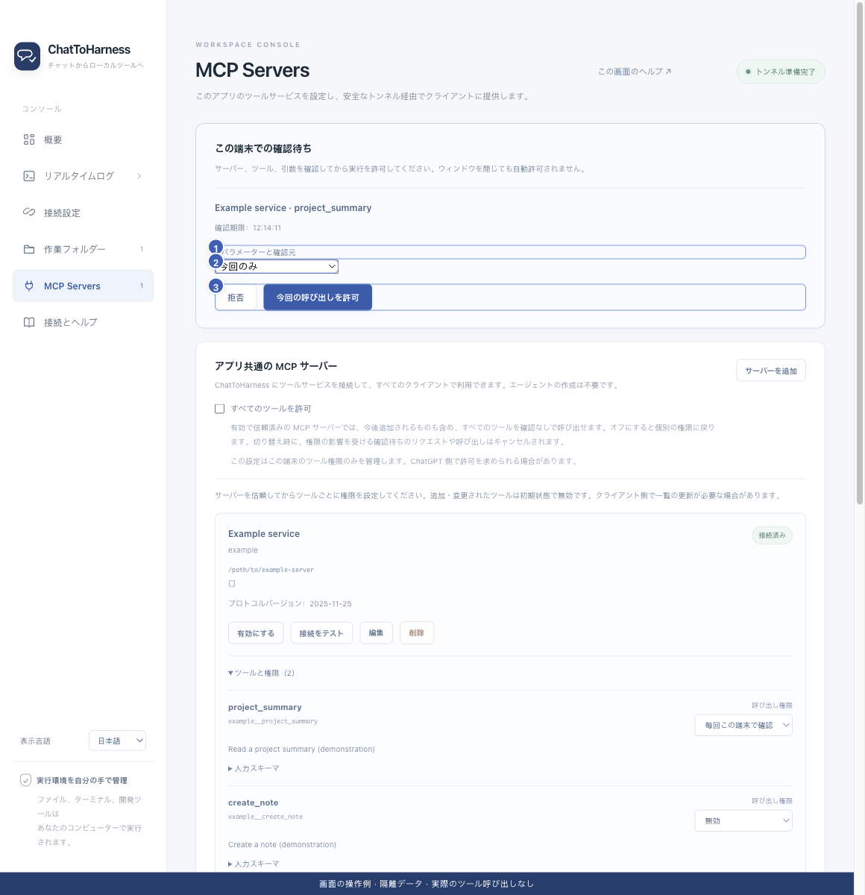

# ツールの権限と本機の確認を管理する

[English](../en/tool-permissions.md) | [简体中文](../zh-CN/tool-permissions.md) | [日本語](../ja/tool-permissions.md)

> ChatToHarness 0.6.0 対象。

## 目的

使える外部ツールと、本機で確認するタイミングを選びます。

## 始める前に

信頼して接続したサービスのツールと権限を展開します。

## 操作手順

1. 各ツールを無効、直接実行、毎回本機で確認に設定します。新規・変更されたツールは通常無効です。
2. 確認待ちになったらアプリ上部のカードを開き、引数と対象を確認します。
3. 今回のみ、対象プロジェクト内で記憶（利用可能時）、ツールを記憶の範囲を選び、許可または拒否します。
4. 記憶を解除する場合は毎回確認に戻し、プロジェクト分は承認の消去を使います。
5. すべてのツールを許可する設定は、有効で信頼済みのサービスの今後追加されるツールにも適用されます。オフで個別設定に戻ります。

1 引数確認、2 記憶する範囲、3 拒否または許可。 現在のリポジトリの画面と隔離サンプルによる操作例です。実際の接続やツール実行の成功を示していません。

## 完了時の状態

権限を与えたツールを利用できます。時限内に確認する必要があり、ウィンドウを閉じても許可されません。

## うまくいかない場合

設定、ツール定義、プロジェクトの変更で記憶が無効になることがあります。プロジェクト承認はプロセスを隔離せず、ChatGPT の確認も別です。一括許可の切替で関係する待機中の依頼や呼び出しが取消される場合があります。

## 次のステップ

- [サービスを信頼して接続テストする](service-trust.md)
- [フォルダー・キー・ツールの権限エラーに対処する](permission-problems.md)
- [アクセス範囲・認証情報・記録を理解する](privacy.md)
