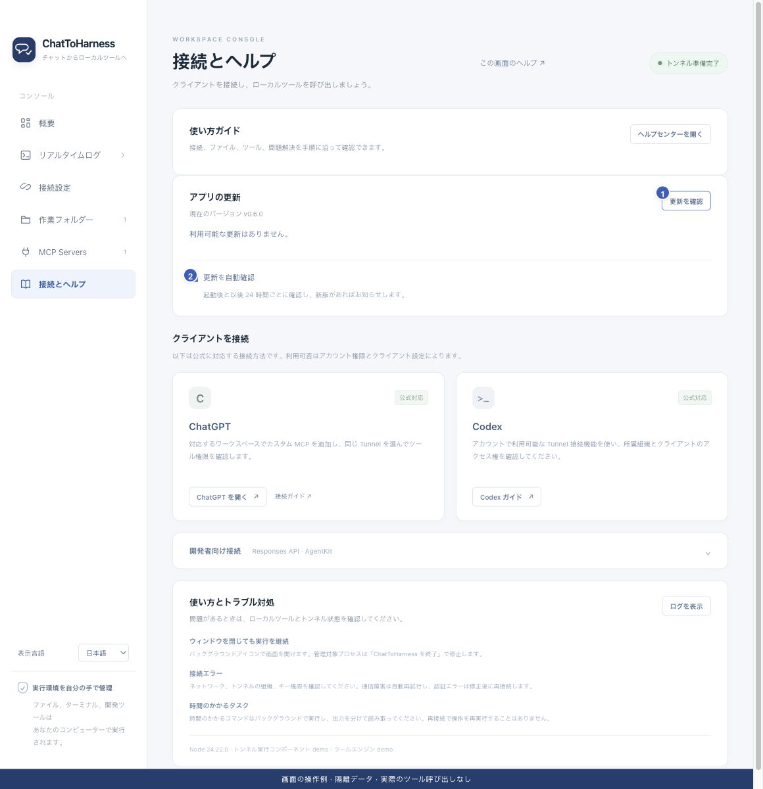

# 更新を確認して新版をインストールする

[English](../en/updates.md) | [简体中文](../zh-CN/updates.md) | [日本語](../ja/updates.md)

> ChatToHarness 0.6.0 対象。

## 目的

変更点を読み、OS に合う新しい版へ更新します。

## 始める前に

未保存の設定とファイルを保存し、独立した永続タスクなど実行中の作業を確認します。

## 操作手順

1. 接続とヘルプで更新確認を選びます。メニューやトレイからも使えます。
2. 新版の説明、対象環境、署名の注意を読みます。
3. ダウンロードしてインストールを選び、取得と整合性の確認を待ちます。
4. 確認後に接続が止まり、インストーラーが開いてアプリが終了します。Mac は新版をアプリケーションへ、Windows はウィザードに従います。
5. 再起動して実行中の版と設定を確認し、再接続します。クライアントでツール一覧を更新するかプラグインを再接続して、新しいツールの説明とパラメーターを読み込みます。その後、[読み取り専用の確認](first-task.md)を行い、実際のツール結果を確認します。
6. 自動確認は初期状態で起動約10秒後と24時間ごとです。通知だけで自動インストールはしません。

1 手動確認、2 自動確認の設定。 現在のリポジトリの画面と隔離サンプルによる操作例です。実際の接続やツール実行の成功を示していません。

## 完了時の状態

現在の版と更新状態が分かります。検証や取得に失敗した場合はインストールを始めません。

## うまくいかない場合

更新確認にトンネルは不要で、ネットワーク失敗は通常の接続に影響しません。開発モードは確認のみです。更新しても独立タスクの停止は保証されないため先に対処します。

既存の会話で古いパラメーターが表示されたり、新しいツールが見つからなかったりする場合は、[ツールが見つからない場合](missing-tools.md)を確認してください。デスクトップアプリの更新だけではクライアントのツール一覧は更新されません。**トンネル準備完了**だけでは、クライアントからの呼び出しを検証したことにはなりません。

## 次のステップ

- [ChatToHarness をインストールする](installation.md)
- [バックグラウンドタスクを開始・確認・取消する](background-tasks.md)
- [アクセス範囲・認証情報・記録を理解する](privacy.md)
