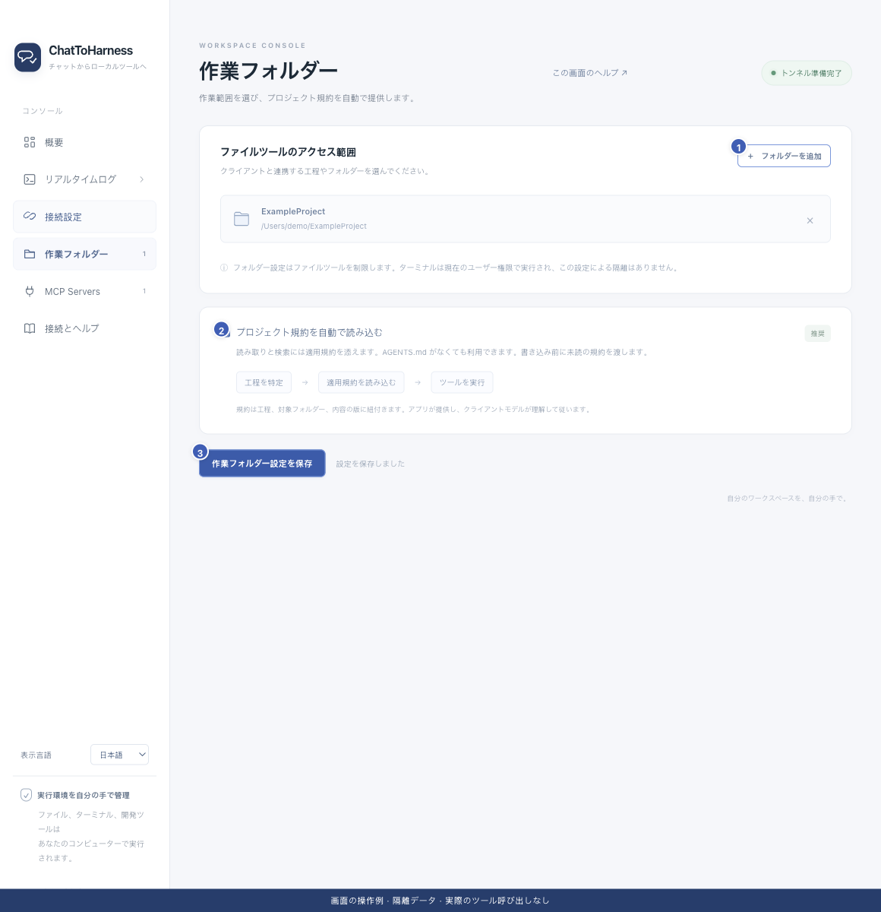

# 作業フォルダーと工程規約を管理する

[English](../en/work-directories.md) | [简体中文](../zh-CN/work-directories.md) | [日本語](../ja/work-directories.md)

> ChatToHarness 0.6.0 対象。

## 目的

ファイルツールの範囲を選び、適用されるプロジェクト説明をクライアントに渡します。

## 始める前に

共同作業に使うフォルダーだけを選びます。許可は本機のアプリで設定します。

## 操作手順

1. 作業フォルダーで追加を選び、プロジェクトなどを指定します。複数追加できます。
2. 不要な項目は横の削除ボタンで外して保存します。実ファイルは削除されません。
3. 必要なら工程規約の自動読み込みを有効にして保存します。
4. チャットには絶対パスを伝えます。AGENTS.md や規則があれば渡され、なくても利用できます。
5. 書き込み前に規約を求められたら、クライアントに読ませて元の操作を続けます。Skills は必要に応じて選択できます。

1 フォルダー追加、2 規約の自動読込、3 設定保存。 現在のリポジトリの画面と隔離サンプルによる操作例です。実際の接続やツール実行の成功を示していません。

## 完了時の状態

保存済みの範囲でファイルを扱えます。規約の配信は、モデルが正しく理解・遵守したことの保証ではありません。

## うまくいかない場合

規約の問題で書き込みが止まっても、読み取りや調査は続けられる場合があります。変更後は再読が必要です。フォルダー許可や記憶した承認は端末や外部プロセスを隔離しません。

## 次のステップ

- [ファイルを探して整理する](files.md)
- [フォルダー・キー・ツールの権限エラーに対処する](permission-problems.md)
- [アクセス範囲・認証情報・記録を理解する](privacy.md)
