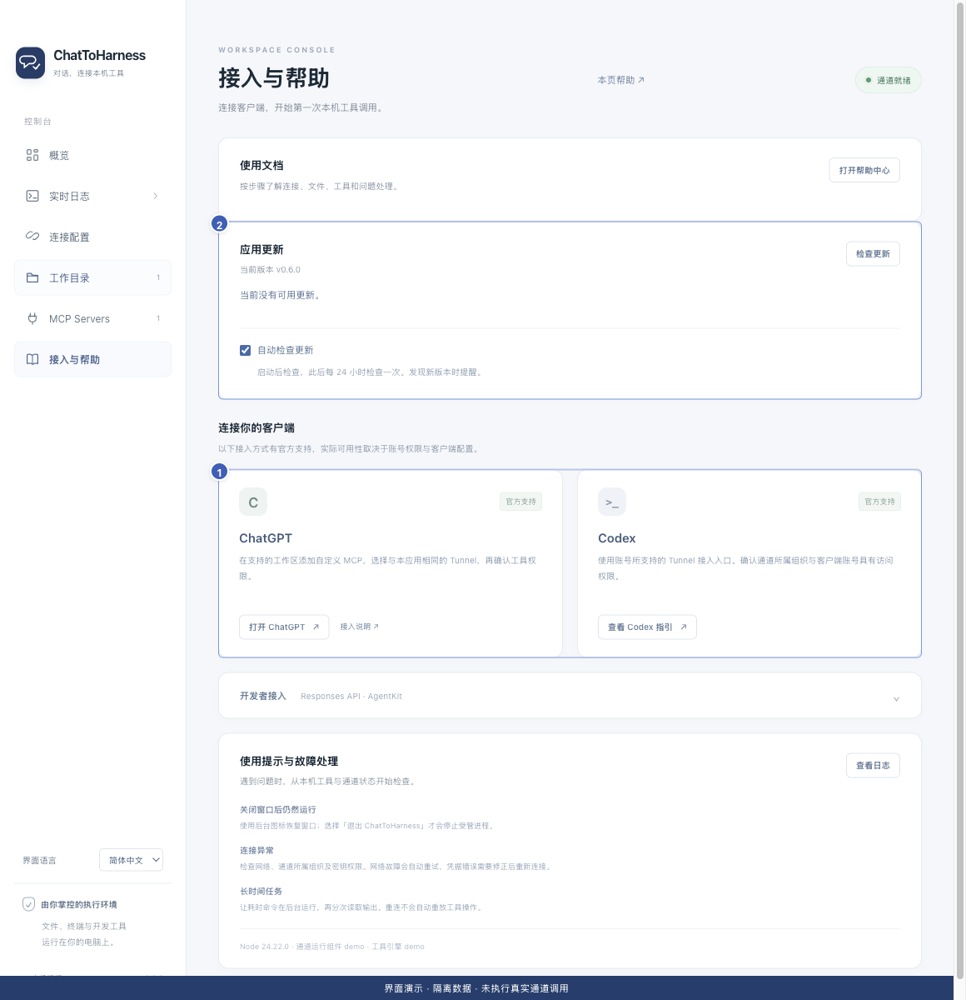

# 连接 ChatGPT

[English](../en/chatgpt.md) | [简体中文](../zh-CN/chatgpt.md) | [日本語](../ja/chatgpt.md)

> 适用于 ChatToHarness 0.6.0。

## 使用目标

让 ChatGPT 使用本机应用已准备好的工具。

## 开始前

本机通道就绪，账号具备自定义 MCP 和目标通道使用权限。

## 操作步骤

1. 打开 ChatGPT 的插件／应用管理入口，按当前账号提供的流程添加自定义 MCP。
2. 在 Connection 中选择 Tunnel，并选择或填写与本机应用相同的 Tunnel ID。
3. 完成账号或工作区要求的授权，等待工具目录出现。
4. 在对话中选择这个插件，发送首次只读检查。已有连接可能仍显示旧名称 LocalHarness。
5. 更新应用或工具后，在插件详情刷新工具，再进行只读验证。

1 客户端接入指引；2 应用更新。 界面演示：使用当前仓库界面与隔离示例数据，不代表真实通道或工具调用成功。

## 完成后的表现

实际工具结果能返回本机项目信息。通道在列表里可见、工具发现成功和实际执行成功是不同阶段。

## 没有成功时

入口或通道不可见时，请管理员检查工作区关联及权限。ChatGPT 的确认独立于本机授权；请核对请求后按提示处理。本文不承诺关闭所有确认。参见下方官方接入说明。

[OpenAI 官方接入说明](https://developers.openai.com/api/docs/guides/custom-mcp-server)

## 下一步

- [完成第一次任务](first-task.md)
- [客户端找不到通道或工具](missing-tools.md)
- [管理工具权限与本机确认](tool-permissions.md)
