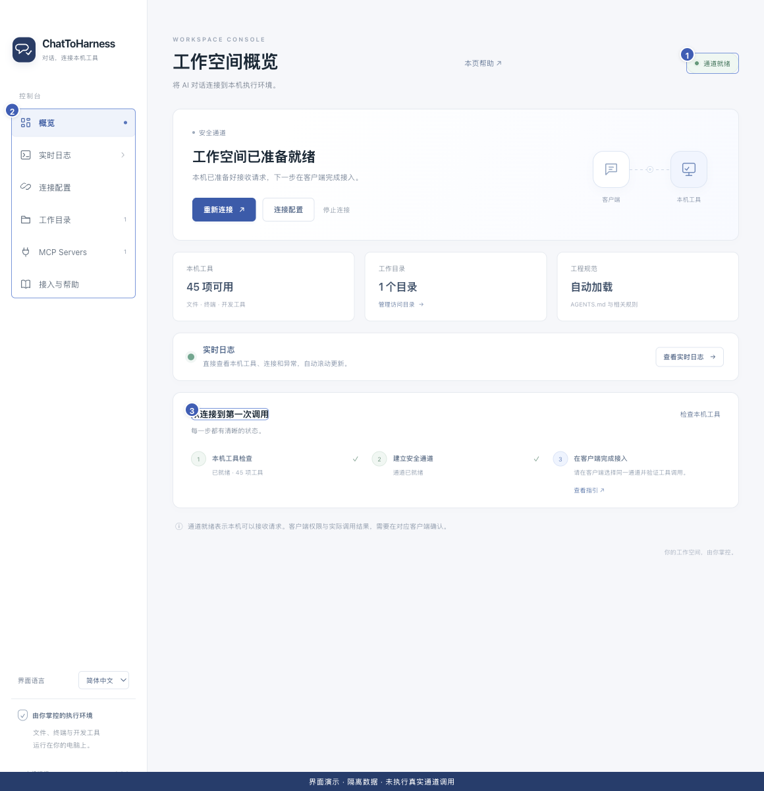

# 认识控制台

[English](../en/console-tour.md) | [简体中文](../zh-CN/console-tour.md) | [日本語](../ja/console-tour.md)

> 以下步骤对应 [ChatToHarness v0.8.1](https://github.com/DJ-Huang/ChatToHarness/releases/tag/v0.8.1) 的插件界面。

## 使用目标

知道每类操作从哪里开始，以及在哪里查看结果。

## 开始前

打开 ChatToHarness。首次使用可以先浏览，不必立即填写密钥。

## 操作步骤

1. 概览：查看连接状态、本机工具和首次调用步骤，连接或停止通道。
2. 连接配置：保存通道与运行密钥，设置打开应用时自动连接。
3. 工作目录：添加或移除文件工具范围，设置自动加载工程规范。
4. **插件**：点击**添加插件**接入外部服务，或点击插件卡片的**管理**查看设置、信任和工具权限。
5. 实时日志：持续观察连接和工具事件；展开该入口可进入执行记录。
6. 接入与帮助：查看客户端指引、帮助中心和应用更新；侧栏底部切换语言。

1 连接状态；2 功能入口；3 首次调用步骤。 历史界面演示，使用隔离示例数据；v0.8.1 的菜单与面板位置请以上述步骤为准。此图不代表真实通道或工具调用成功。

## 完成后的表现

你能找到设置入口和排查入口。执行记录是实时日志下的子菜单，首次默认收起。

## 没有成功时

找不到执行记录时，再点一次实时日志展开子菜单，或使用日志页的“查看执行记录”快捷入口。不同版本入口可能略有变化，以当前应用为准。

## 下一步

- [查看和筛选实时日志](live-logs.md)
- [管理工作目录和项目规范](work-directories.md)
- [添加本地 MCP 服务](local-services.md)
