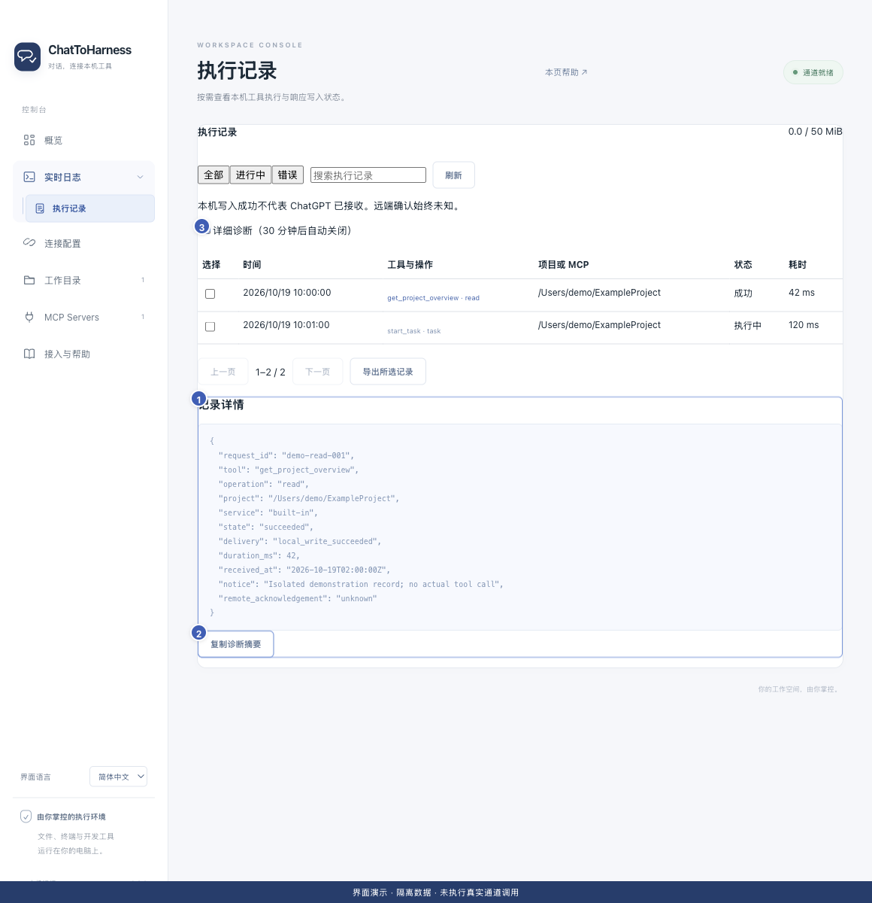

# 开启详细诊断、复制和导出记录

[English](../en/diagnostics.md) | [简体中文](../zh-CN/diagnostics.md) | [日本語](../ja/diagnostics.md)

> 适用于 ChatToHarness 0.6.0。

## 使用目标

为具体问题收集必要证据，并在分享前检查内容。

## 开始前

准备复现步骤，先查看现有执行记录能否说明问题。

## 操作步骤

1. 需要更多细节时，在执行记录开启“详细诊断”。它会在 30 分钟后自动关闭，也可提前关闭。
2. 复现一次问题，记下时间和请求 ID，避免反复执行会修改数据的操作。
3. 打开相关记录详情，用“复制诊断摘要”复制需要的信息。
4. 勾选相关记录，点击“导出所选记录”，保存下载的 JSON 文件；一次最多选择 100 条。
5. 检查导出内容，移除不应分享的路径、项目内容、参数或其他私人数据，再附到问题报告。

1 记录详情；2 复制详情；3 详细诊断开关。 界面演示：使用当前仓库界面与隔离示例数据，不代表真实通道或工具调用成功。

## 完成后的表现

得到与问题相关的记录和时间线。导出只覆盖所选记录，不是全部配置或聊天备份。

## 没有成功时

日志和详情可能含用户数据，脱敏并非绝对保证。可清理日志共享 50 MiB 预算，执行记录最长保留 7 天／最多 10,000 条；重要证据应及时保存，详细诊断不是无限保存开关。

## 下一步

- [了解访问范围、凭据与本地记录](privacy.md)
- [常见问题与如何求助](faq.md)
- [查找与理解执行记录](execution-records.md)
