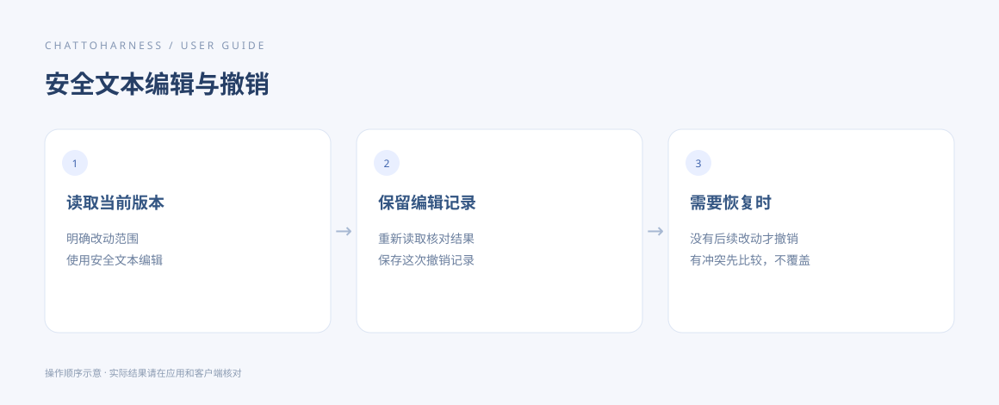

# 修改文件与安全撤销

[English](../en/editing.md) | [简体中文](../zh-CN/editing.md) | [日本語](../ja/editing.md)

> 适用于 ChatToHarness 0.6.0。

## 使用目标

准确修改指定内容，并在支持时保留可撤销的记录。

## 开始前

先读取当前内容。重要资料保留副本；安全文本编辑适用于不超过 1 MiB 的 UTF-8 普通文本。

## 操作步骤

1. 说明文件路径、要修改的内容与应保留的内容，先让客户端读取当前版本。
2. 文本修改可要求使用安全编辑并保留撤销记录；新建文件时确认该路径尚不存在。
3. 完成后重新读取，核对只发生了预期改动。
4. 要撤销时指出具体那次安全编辑，让客户端使用对应的撤销记录。
5. Word、Excel、PDF 使用各自格式工具；这些修改不自动具备安全文本撤销能力。

### 可复制的示例

请将示例路径替换为本机已授权的工程绝对路径；Windows 使用自己的盘符路径。

```text
先读取 /Users/demo/ExampleProject/notes.txt，把标题“草稿”改为“会议记录”。使用安全文本编辑并保留撤销记录，完成后重新读取核对。
```



操作指引示意图，展示操作顺序，不是客户端实际执行结果。

说明文字是新建、追加还是局部替换；修改 Word 段落或表格单元格时，明确段落或工作表及范围，并在完成后重新读取。

## 完成后的表现

安全编辑成功会返回撤销记录。撤销成功后，文件恢复到那次编辑前的内容。

## 没有成功时

文件被你或其他程序再次修改后，安全撤销会拒绝覆盖。先比较当前内容再决定如何修复。终端命令、移动文件和任意编辑都不保证可撤销；同时外部写入也不能完全防护。

## 下一步

- [阅读文档、图片与表格](reading.md)
- [执行超时、状态未知或没有收到结果](uncertain-results.md)
