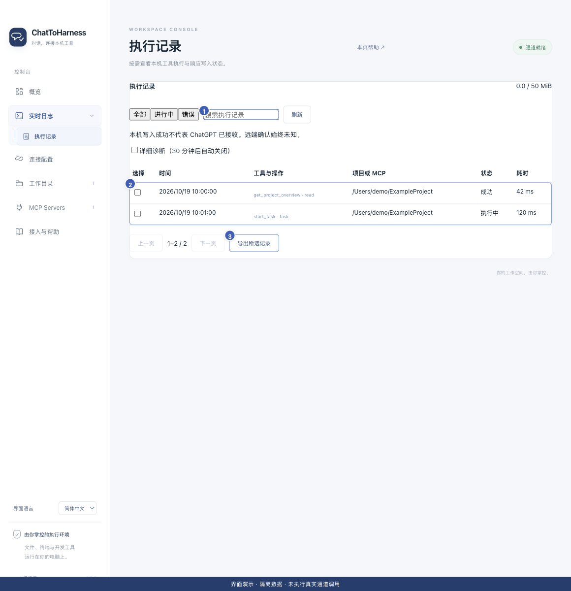

# 查找与理解执行记录

[English](../en/execution-records.md) | [简体中文](../zh-CN/execution-records.md) | [日本語](../ja/execution-records.md)

> 适用于 ChatToHarness 0.6.0。

## 使用目标

确认某次请求在本机的执行情况，再决定是否继续或重试。

## 开始前

打开实时日志并展开其子菜单，或使用日志页的执行记录快捷入口。

## 操作步骤

1. 进入“执行记录”，按全部、进行中或错误筛选。
2. 用工具名、请求 ID 或项目关键词搜索，需要时刷新和翻页。
3. 点击某条记录的“工具与操作”查看详情。
4. 核对时间、项目或服务、执行状态、耗时及关联任务。
5. 区分“本机执行成功”“响应已写入本机通道”和客户端实际收到结果。
6. 如果有任务 ID，继续查询该任务，而不是重复启动。

在聊天中，直接调用 `get_execution_summary`，提供已授权的 `project_path` 和 `state:"errors"` 即可查询最近异常。返回请求 ID、工具名、状态、耗时、错误原因及可能关联的任务 ID，不包含原始参数和完整输出。默认 10 条、最多 50 条；可用 `tool`、`since` 和返回的游标筛选或翻页。

1 搜索；2 执行记录列表；3 导出选中记录。 界面演示：使用当前仓库界面与隔离示例数据，不代表真实通道或工具调用成功。

## 完成后的表现

可以将客户端中的一次操作对应到本机记录，并知道已确认到哪一步。没有客户端回执时，远端是否收到仍可能未知。

## 没有成功时

没有记录不等于操作绝对没执行，记录可能超过保留期限或搜索条件不匹配。先清除筛选，核对时间和目标。结果未知的写入应先检查实际文件或外部应用。

## 下一步

- [执行超时、状态未知或没有收到结果](uncertain-results.md)
- [开启详细诊断、复制和导出记录](diagnostics.md)
- [启动、查看和取消后台任务](background-tasks.md)
