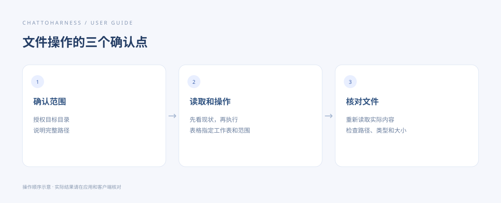

# 浏览和整理文件

[English](../en/files.md) | [简体中文](../zh-CN/files.md) | [日本語](../ja/files.md)

> 适用于 ChatToHarness 0.6.0。

## 使用目标

让 AI 找到指定文件，并按明确范围整理文件夹。

## 开始前

将目标目录加入“工作目录”并保存。路径示例：Mac /Users/demo/ExampleProject，Windows C:\Users\demo\ExampleProject。

## 操作步骤

1. 先要求列出文件夹，按名称、类型或大小定位文件；需要时查看文件信息。
2. 新建文件夹时说明完整位置和名称。
3. 移动或重命名时同时给出来源、目标和允许处理的文件清单。
4. 如果目标名称已存在，要求先报告冲突，不覆盖。
5. 操作后重新列出原位置和目标位置，核对实际结果。

### 可复制的示例

请将示例路径替换为本机已授权的工程绝对路径；Windows 使用自己的盘符路径。

```text
列出 /Users/demo/ExampleProject 顶层文件及其类型和大小，不要移动、重命名或删除文件。
```



操作指引示意图，展示操作顺序，不是客户端实际执行结果。

## 完成后的表现

目录列表反映预期的新位置或名称，未指定的文件保持原样。

## 没有成功时

无法访问时检查目录授权；嵌套路径和快捷链接的实际目标也必须在授权范围内。应用没有通用回收站或“一键撤销所有整理”，移动前先确认范围。

## 下一步

- [阅读文档、图片与表格](reading.md)
- [搜索文件和内容](search.md)
- [管理工作目录和项目规范](work-directories.md)
