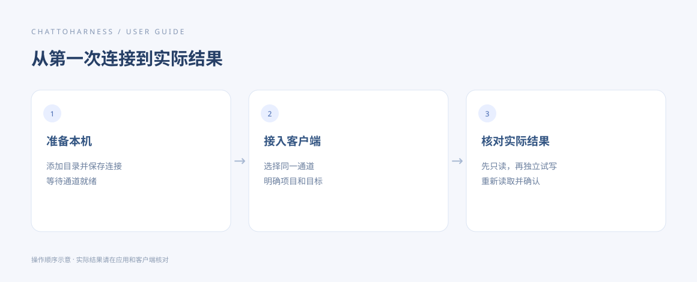

# 完成第一次任务

[English](../en/first-task.md) | [简体中文](../zh-CN/first-task.md) | [日本語](../ja/first-task.md)

> 适用于 ChatToHarness 0.6.0。

## 使用目标

用一次只读检查和一次独立文件试写，确认整条连接可用。

## 开始前

已在应用中授权空的试用文件夹，通道就绪，客户端已发现工具。示例中的工程路径请换成自己的绝对路径。

## 操作步骤

1. 在客户端选择 ChatToHarness 对应的已连接插件，再发送下方只读示例。
2. 检查返回结果中确实出现该文件夹的文件列表或项目信息。模型说“已完成”本身不算验证。
3. 继续要求在试用文件夹中新建一个从未存在过的 hello-harness.txt，内容为“连接测试”，并再次读取。
4. 核对返回内容与本地文件；可在执行记录中找到对应调用。
5. 需要清理时，明确要求只处理这个测试文件，或在系统文件管理器中手动移除。

### 可复制的示例

请将示例路径替换为本机已授权的工程绝对路径；Windows 使用自己的盘符路径。

```text
查看 /Users/demo/ExampleProject 的项目概览和文件列表，不要修改任何文件。
```



操作指引示意图，展示操作顺序，不是客户端实际执行结果。

## 完成后的表现

只读结果和试写后的重新读取都成功，说明客户端实际用到了本机工具。

## 没有成功时

没有结果时先查看执行记录，避免反复创建同名文件。首次写入如果提示先读取项目规范，让客户端阅读后继续原请求；只有收到实际工具结果才算完成。

## 下一步

- [阅读文档、图片与表格](reading.md)
- [修改文件与安全撤销](editing.md)
- [查找与理解执行记录](execution-records.md)
