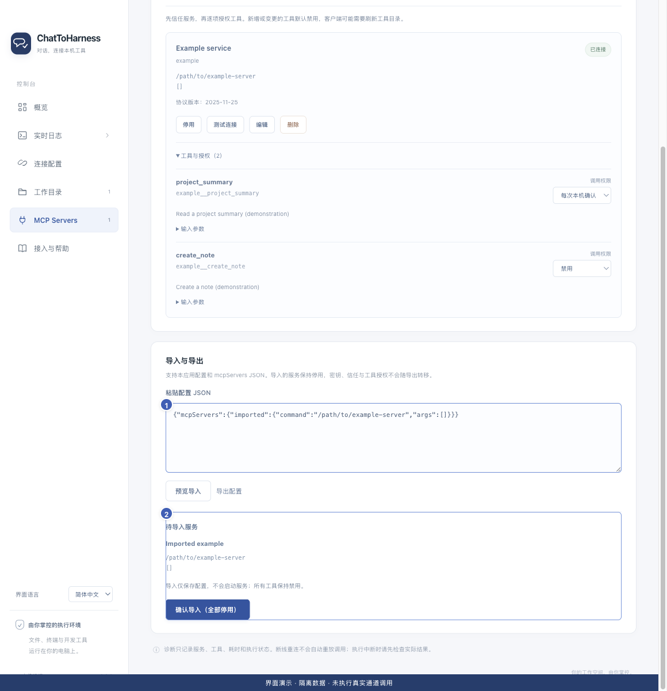

# 导入和导出工具配置

[English](../en/import-export.md) | [简体中文](../zh-CN/import-export.md) | [日本語](../ja/import-export.md)

> 适用于 ChatToHarness 0.6.0。

## 使用目标

复用服务配置，同时在目标电脑重新完成密钥和权限设置。

## 开始前

只使用可信来源配置。启动命令可能需要按目标电脑调整。

## 操作步骤

1. 在 MCP Servers 的“导入与导出”粘贴本应用导出内容或常见 mcpServers 配置。
2. 点击“预览导入”，检查每个服务、命令、地址和缺失项；此时不会启动服务。
3. 核对后点击“确认导入（全部停用）”。
4. 在目标电脑补齐所需密钥、路径，重新信任、授权工具并连接。
5. 导出时点击“导出配置”并复制保存结果；妥善存放这份配置。

1 粘贴可信配置；2 预览并确认，导入后保持停用。 界面演示：使用当前仓库界面与隔离示例数据，不代表真实通道或工具调用成功。

导出后使用“复制配置”保存本地副本；这与导出所选执行记录是不同操作。

## 完成后的表现

导入的服务保持停用。导出不包含密钥值、信任记录或工具授权，不能当作完整账户备份。

## 没有成功时

出现配置冲突或预览过期时重新预览，不要直接执行陌生命令。跨 Mac 和 Windows 时检查命令路径及平台覆盖。导出不包含通道密钥、工作目录及全部个人设置。

## 下一步

- [添加本地 MCP 服务](local-services.md)
- [管理工具权限与本机确认](tool-permissions.md)
- [更换或清除连接凭据](credentials.md)
