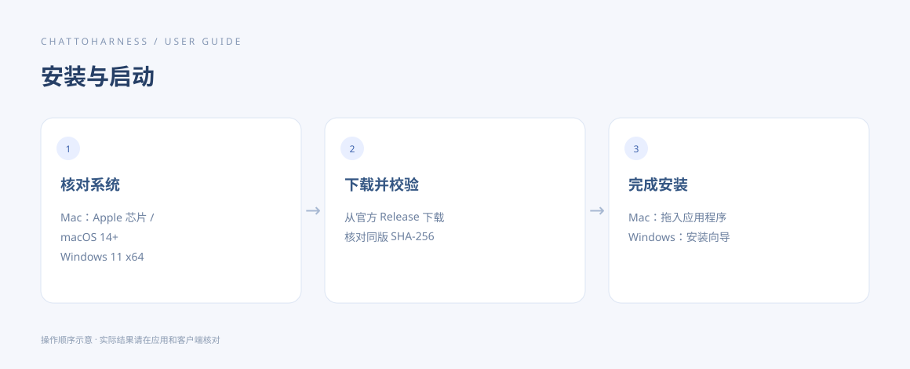

# 安装 ChatToHarness

[English](../en/installation.md) | [简体中文](../zh-CN/installation.md) | [日本語](../ja/installation.md)

> 下方安装包示例和签名说明对应正式 [v0.8.1 Release](https://github.com/DJ-Huang/ChatToHarness/releases/tag/v0.8.1)。使用其他版本时，请以该版本的文件名、校验文件和发布说明为准。

## 使用目标

安装适合当前电脑的正式版本，并打开控制台。

## 开始前

先确认系统要求和账号条件。从官网进入 GitHub Releases。

## 操作步骤

1. 从官方 Release 下载适合当前系统的安装包：Mac 选择 Apple 芯片的 .dmg，Windows 选择 x64 的 -setup.exe。
2. 下载同一 Release 的 SHA256SUMS.txt。打开安装包前，按下方步骤核对下载文件，并阅读该版本签名说明。
3. 校验通过后再安装。Mac：打开 .dmg，将应用拖入“应用程序”。Windows：运行 -setup.exe，按安装向导选择位置并完成安装。
4. 打开应用，确认出现“概览”“连接配置”“工作目录”等入口。

### 打开安装包前核对下载文件

下方只读命令假设两个文件都保存在“下载”文件夹，并保留原文件名。如果保存到了其他位置，或浏览器为重复下载的文件改了名，请替换路径。安装包与 SHA256SUMS.txt 必须来自同一 Release；不要把仓库的源码 ZIP 当作安装包。

Mac：打开“终端”并运行：

```sh
shasum -a 256 "$HOME/Downloads/ChatToHarness-0.8.1-macos-arm64.dmg"
cat "$HOME/Downloads/SHA256SUMS.txt"
```

Windows：打开 PowerShell 并运行：

```powershell
(Get-FileHash -Algorithm SHA256 -LiteralPath "$HOME\Downloads\ChatToHarness-0.8.1-windows-x64-setup.exe").Hash
Get-Content -LiteralPath "$HOME\Downloads\SHA256SUMS.txt"
```

第一条命令输出下载文件的 SHA-256。将这段 64 个字符的值与 SHA256SUMS.txt 中**同一安装包文件名**前的值逐个比较，字母大小写不影响比较。校验文件同时列出两个平台，只需核对自己下载的安装包；完整值一致后再继续。

如果提示找不到文件，先修正路径。如果校验值不同，不要打开安装包：核对文件名与版本，再从官方 Release 重新下载安装包和校验文件。校验一致只说明文件字节与发布的校验值相符，不能代替代码签名或公证，也不能单独证明软件安全。请保持系统保护开启。



操作指引示意图，展示操作顺序，不是客户端实际执行结果。

## 完成后的表现

可以看到控制台。安装结束并不代表通道已连接，下一步需要填写连接资料。

## 没有成功时

v0.8.1 的 Mac 应用为临时签名且未公证，Windows 安装包未签名，系统可能提示或阻止安装。先核对来源、校验值和发布说明，再决定是否继续；不要关闭整个系统的安全保护。不要下载与架构不符的安装包。

[GitHub Releases](https://github.com/DJ-Huang/ChatToHarness/releases)

## 下一步

- [建立第一次连接](first-connection.md)
- [安装受阻或无法启动](installation-problems.md)
