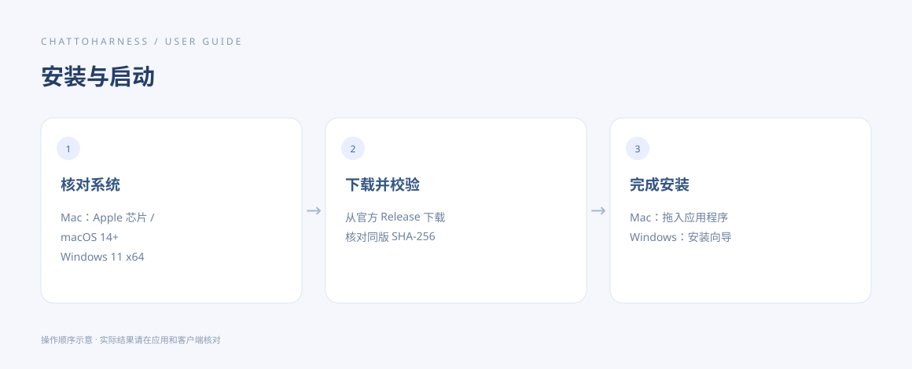

# 安装 ChatToHarness

[English](../en/installation.md) | [简体中文](../zh-CN/installation.md) | [日本語](../ja/installation.md)

> 适用于 ChatToHarness 0.6.0。

## 使用目标

安装适合当前电脑的正式版本，并打开控制台。

## 开始前

先确认系统要求和账号条件。从官网进入 GitHub Releases。

## 操作步骤

1. 从官方 Release 下载适合当前系统的安装包：Mac 选择 Apple 芯片的 .dmg，Windows 选择 x64 的 -setup.exe。
2. 打开安装包前，对照同一 Release 的 SHA256SUMS.txt 核对下载文件，并阅读该版本签名说明。
3. 校验通过后再安装。Mac：打开 .dmg，将应用拖入“应用程序”。Windows：运行 -setup.exe，按安装向导选择位置并完成安装。
4. 打开应用，确认出现“概览”“连接配置”“工作目录”等入口。

操作指引示意图，展示操作顺序，不是客户端实际执行结果。

## 完成后的表现

可以看到控制台。安装结束并不代表通道已连接，下一步需要填写连接资料。

## 没有成功时

v0.6.0 的 Mac 应用未公证，Windows 安装包未签名，系统可能拦截。先核对来源和校验值，再按系统安全设置处理；不要关闭整个系统的安全保护。不要下载与架构不符的安装包。

[GitHub Releases](https://github.com/DJ-Huang/ChatToHarness/releases)

## 下一步

- [建立第一次连接](first-connection.md)
- [安装受阻或无法启动](installation-problems.md)
