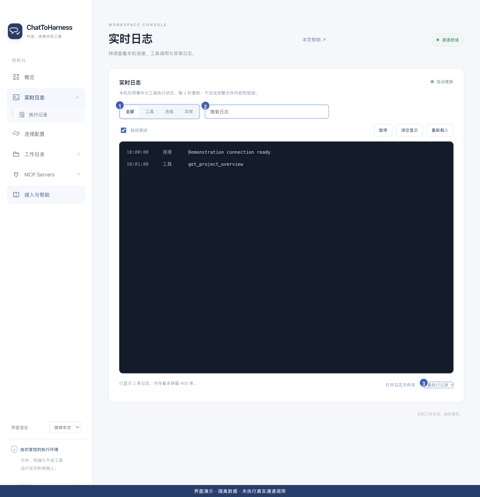

# 查看和筛选实时日志

[English](../en/live-logs.md) | [简体中文](../zh-CN/live-logs.md) | [日本語](../ja/live-logs.md)

> 适用于 ChatToHarness 0.6.0。

## 使用目标

在一个持续更新的视图中观察连接和工具事件。

## 开始前

应用中已有连接或工具活动；日志展示近期内容，不是完整聊天记录。

## 操作步骤

1. 点击侧栏“实时日志”，或概览中的快捷入口。
2. 选择全部、工具、连接或异常，按你正在排查的现象筛选。
3. 在搜索框输入工具名、请求 ID 或关键词；没有结果时清除搜索并换一个分类。
4. 需要停下来阅读时点击“暂停”，之后选择继续；可关闭自动滚动。
5. “重新载入”刷新近期视图；“清空显示”只清空界面，不删除磁盘日志。
6. 通过底部入口打开日志文件夹，或进入执行记录查看具体调用。

1 分类筛选；2 搜索；3 执行记录入口。 界面演示：使用当前仓库界面与隔离示例数据，不代表真实通道或工具调用成功。

## 完成后的表现

日志约每两秒更新。暂停只停止界面更新，不会暂停工具执行。

## 没有成功时

这是有界近期视图，高频事件可能跳过部分中间内容；不能当作完整审计记录。待读取规范、待补参数等尚未执行的请求不一定进入异常分类，可在全部或工具分类查找。

## 下一步

- [查找与理解执行记录](execution-records.md)
- [开启详细诊断、复制和导出记录](diagnostics.md)
