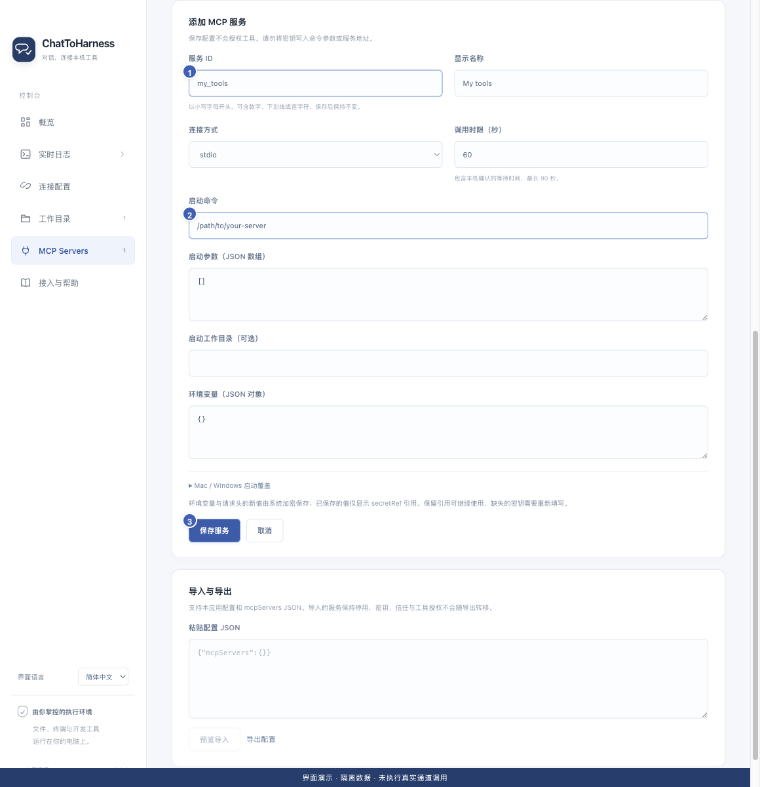

# 添加本地 MCP 服务

[English](../en/local-services.md) | [简体中文](../zh-CN/local-services.md) | [日本語](../ja/local-services.md)

> 适用于 ChatToHarness 0.6.0。

## 使用目标

把电脑上已安装的外部工具接入本应用。

## 开始前

先按该工具的官方手册安装服务，取得启动命令、参数和必要密钥。应用不会自动安装所有外部工具。

## 操作步骤

1. 打开 MCP Servers，点击“添加服务”。
2. 填写稳定的服务 ID 与显示名称；ID 保存后不可更改，可使用 my_tools 之类名称。
3. 连接方式选择 stdio，按服务手册填启动命令与参数。无参数填 []，多个参数各占一个字符串。
4. 需要时填写启动工作目录和环境变量；在专用字段填密钥，不放入命令参数。
5. 不同电脑的启动路径可能不同，可在 Mac / Windows 启动覆盖中分别填写。调用时限包含等待本机确认的时间。
6. 保存后继续核对信任、测试连接，再逐项授权工具。

1 固定服务 ID；2 官方启动命令；3 保存配置。 界面演示：使用当前仓库界面与隔离示例数据，不代表真实通道或工具调用成功。

## 完成后的表现

服务显示在列表中。保存配置本身没有授权任何工具，也不代表连接已成功。

## 没有成功时

命令不存在时先检查安装和绝对路径，含空格的参数按独立项填写。服务以你的用户权限运行，工作目录白名单不限制它。截图中的命令只是演示，必须换成官方实际命令。

## 下一步

- [信任服务与测试连接](service-trust.md)
- [管理工具权限与本机确认](tool-permissions.md)
- [导入和导出工具配置](import-export.md)
