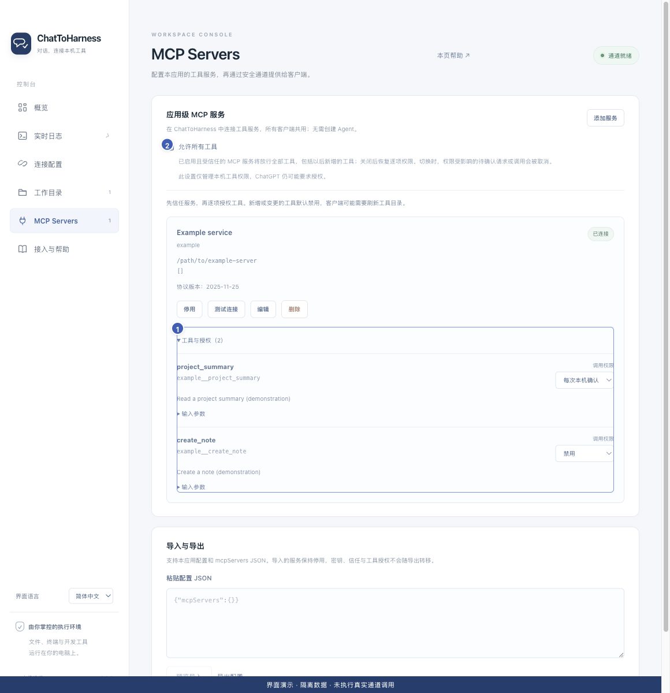

# 编辑、启停与删除服务

[English](../en/manage-services.md) | [简体中文](../zh-CN/manage-services.md) | [日本語](../ja/manage-services.md)

> 以下步骤对应 [ChatToHarness v0.8.1](https://github.com/DJ-Huang/ChatToHarness/releases/tag/v0.8.1) 的插件界面。

## 使用目标

维护外部工具连接，并理解单个服务和整条通道的区别。

## 开始前

先查看服务是否有进行中的操作，必要时等待结果或明确取消。

## 操作步骤

1. 打开**插件**，找到外部 MCP 服务，点击卡片上的**管理**，展开右侧管理面板。
2. 在**概览与权限**中查看状态和工具。要修改配置，切换到**连接配置**，也可点击概览中的“编辑”。服务 ID 保持不变，启动目标变化后需要重新确认信任。
3. 在**概览与权限**中点击“停用”，只停止该服务；需要时再次启用并检查状态。
4. 移除服务时，在同一概览中点击“删除”，核对后再“确认删除”；这会停止服务并移除配置。
5. 服务或权限变化后，在客户端刷新工具目录，再进行一次只读检查。

1 工具与逐项授权；2 可选的全部工具许可。历史界面演示，使用隔离示例数据；v0.8.1 的菜单与管理面板位置请以上述步骤为准。此图不代表真实通道或工具调用成功。

## 完成后的表现

服务状态和客户端可用目录反映当前启用与授权情况。所有使用同一通道的客户端共用这些设置。

## 没有成功时

“停止连接”会停止通道和全部受管服务，关闭窗口不会。传输故障会独立重连，但不会重放业务操作。删除配置不会自动卸载第三方软件。

## 下一步

- [导入和导出工具配置](import-export.md)
- [客户端找不到通道或工具](missing-tools.md)
