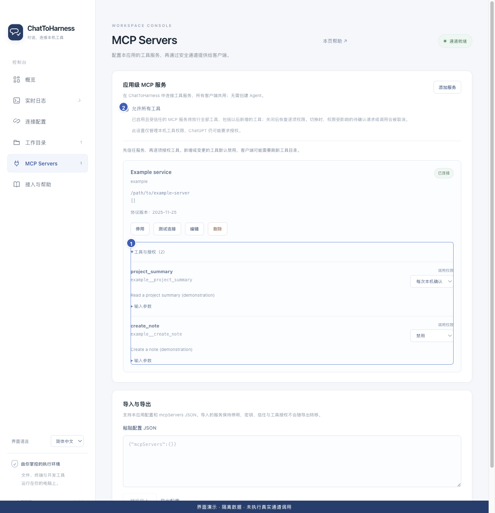

# 客户端找不到通道或工具

[English](../en/missing-tools.md) | [简体中文](../zh-CN/missing-tools.md) | [日本語](../ja/missing-tools.md)

> 适用于 ChatToHarness 0.6.0。

## 使用目标

沿着应用、账号和工具目录逐层检查缺失的入口。

## 开始前

保持本机应用运行，确认需要的是内置文件工具还是某个外部服务工具。

## 操作步骤

1. 通道不可见：检查目标 ChatGPT 工作区和 Platform 组织已关联，操作者具有使用权限。
2. 本机不就绪：先处理概览中的连接错误。
3. 内置文件工具不可用：添加并保存至少一个允许的工作目录。
4. 外部工具不可用：确认服务已启用、已信任、连接成功，并且所需工具没有禁用。
5. 在客户端插件详情刷新工具目录，再选中正确插件或新建任务进行只读检查。已有插件可能仍名为 LocalHarness。

1 工具与逐项授权；2 可选的全部工具许可。 界面演示：使用当前仓库界面与隔离示例数据，不代表真实通道或工具调用成功。

## 完成后的表现

客户端能发现当前已授权的目录，并能进行实际调用。外部工具名称通常带服务 ID 前缀。

## 没有成功时

应用显示工具可用不等于当前对话已刷新。客户端不支持资源浏览器时可通过只读查询工具查看资源。第三方服务没有提供的能力不会因为连接成功而自动出现。

## 下一步

- [连接 ChatGPT](chatgpt.md)
- [连接 Codex](codex.md)
- [管理工具权限与本机确认](tool-permissions.md)
