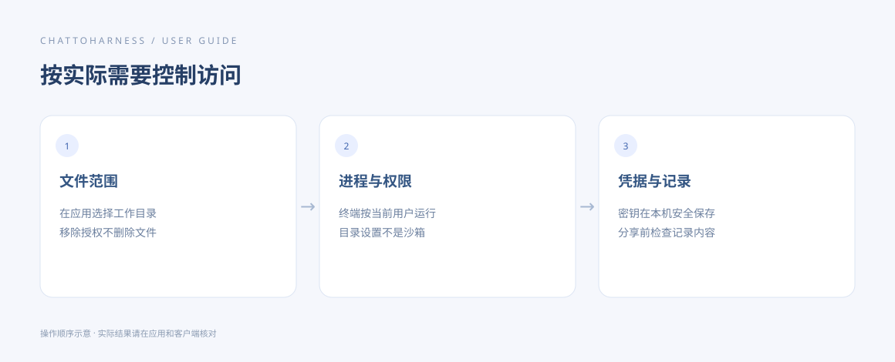

# 了解访问范围、凭据与本地记录

[English](../en/privacy.md) | [简体中文](../zh-CN/privacy.md) | [日本語](../ja/privacy.md)

> 适用于 ChatToHarness 0.6.0。

## 使用目标

知道哪些内容由本机保存，哪些操作仍需自己控制范围。

## 开始前

区分文件工具、终端、外部工具服务和所连接的 AI 客户端。

## 操作步骤

1. 文件工具：通过工作目录设置访问范围；移除授权不删除文件。
2. 终端与外部进程：按当前用户权限运行，目录白名单不构成沙箱。
3. 凭据：通道密钥和服务密钥由系统加密保存，保存后不回显原值；工具配置导出只带引用。
4. 记录：诊断、执行详情和任务输出有保存上限，也可能含项目内容或路径；分享前自行检查。
5. 连接与结果：客户端会接收到任务相关的工具结果，具体服务的数据处理规则仍由各自政策决定。
6. 需要减少访问时，在本机移除目录、禁用工具或服务，并停止连接；持久任务另行取消。

操作指引示意图，展示操作顺序，不是客户端实际执行结果。

## 完成后的表现

你能按实际需求控制访问，并知道本机保存的记录和客户端收到的结果属于不同位置。

## 没有成功时

没有日志不代表没有数据，脱敏也不保证覆盖所有凭据。不要在命令输出、参数或截图里放密钥。删除服务配置不会删除第三方软件或保证清除所有历史记录。

## 下一步

- [管理工作目录和项目规范](work-directories.md)
- [管理工具权限与本机确认](tool-permissions.md)
- [开启详细诊断、复制和导出记录](diagnostics.md)
