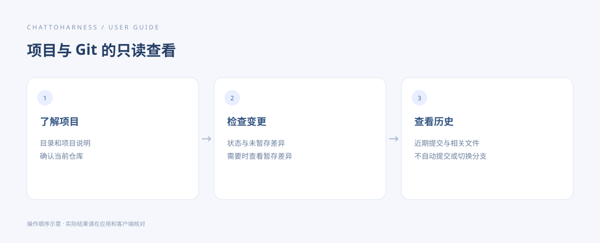

# 了解项目与查看 Git 变更

[English](../en/project-git.md) | [简体中文](../zh-CN/project-git.md) | [日本語](../ja/project-git.md)

> 适用于 ChatToHarness 0.6.0。

## 使用目标

了解项目结构，并只读查看当前修改和提交历史。

## 开始前

项目位于已授权目录。Git 查询需要电脑可用的 Git，目标本身应是 Git 仓库。

## 操作步骤

1. 先要求项目概览，了解目录、当前状态及可用的项目说明。
2. 查看 Git 状态，区分已暂存、未暂存和未跟踪文件。
3. 指定要看的差异范围：默认未暂存改动，也可明确要求暂存改动或特定文件。
4. 按需要查看近期提交，说明数量和关注的文件。
5. 将摘要对应到具体文件；结果过多时继续读取后续页。

### 可复制的示例

请将示例路径替换为本机已授权的工程绝对路径；Windows 使用自己的盘符路径。

```text
查看 /Users/demo/ExampleProject 的项目概览、Git 状态和未暂存差异，概括变化，不执行提交或修改。
```



操作指引示意图，展示操作顺序，不是客户端实际执行结果。

## 完成后的表现

得到实际项目摘要、变更和历史信息。这些只读查询不会提交、切换分支或修改文件。

## 没有成功时

不是 Git 仓库或找不到 Git 时，先报告原因；普通文件阅读仍可继续。部分结果和过期页应明确说明。不要把查看差异误当作已经提交变更。

## 下一步

- [搜索文件和内容](search.md)
- [阅读文档、图片与表格](reading.md)
