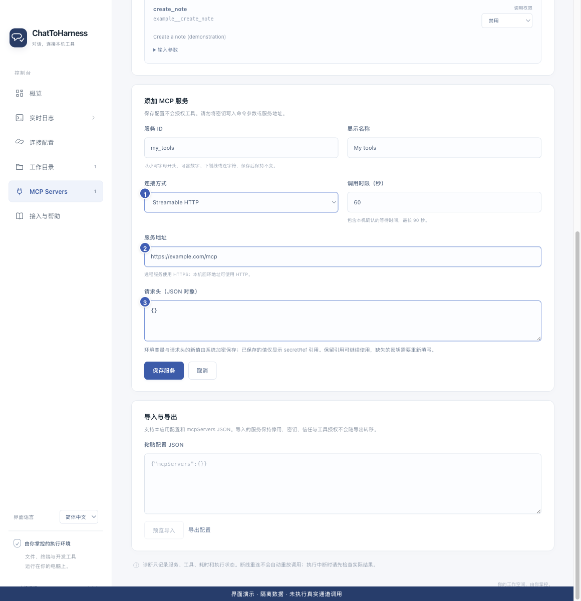

# 添加远程 MCP 服务

[English](../en/remote-services.md) | [简体中文](../zh-CN/remote-services.md) | [日本語](../ja/remote-services.md)

> 适用于 ChatToHarness 0.6.0。

## 使用目标

连接服务商提供的远程工具地址。

## 开始前

取得服务商明确提供的 Streamable HTTP MCP 地址及认证要求。

## 操作步骤

1. 打开 MCP Servers 并添加服务，填写服务 ID 与显示名称。
2. 连接方式选择 Streamable HTTP，填写服务地址。远程地址必须使用 HTTPS；HTTP 仅支持本机回环地址。
3. 按服务商要求填写请求头，例如认证信息；在本机保存，不要放到 URL 查询或聊天中。
4. 确认服务要求的是静态密钥认证。本版不支持 OAuth 登录流程或旧式 HTTP+SSE。
5. 保存并核对实际地址，再测试连接、授权工具。

1 连接方式；2 远程地址；3 认证请求头。 界面演示：使用当前仓库界面与隔离示例数据，不代表真实通道或工具调用成功。

## 完成后的表现

服务出现在列表中，测试成功后能预览其实际提供的工具。

## 没有成功时

浏览器能打开网站不代表它提供兼容 MCP 地址。认证失败时检查密钥和所需请求头。不要把 ChatToHarness 的 Tunnel ID 或运行密钥当成第三方服务地址或密钥。

## 下一步

- [信任服务与测试连接](service-trust.md)
- [管理工具权限与本机确认](tool-permissions.md)
