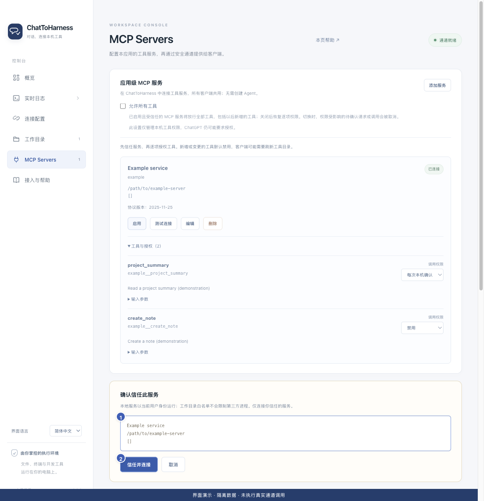

# 信任服务与测试连接

[English](../en/service-trust.md) | [简体中文](../zh-CN/service-trust.md) | [日本語](../ja/service-trust.md)

> 适用于 ChatToHarness 0.6.0。

## 使用目标

在启用前核对外部服务的实际启动目标。

## 开始前

已保存服务配置，并能确认其来源可信。

## 操作步骤

1. 在服务卡片点击“测试连接”或“启用”。
2. 出现信任确认时，核对服务名、实际命令及参数，或远程地址；不确定时取消并查官方手册。
3. 确认后选择“信任并测试”或“信任并连接”。
4. 检查服务状态和工具预览，再进行最小权限配置。
5. 修改启动目标后，再次核对并确认信任。

1 实际连接目标；2 确认信任。 界面演示：使用当前仓库界面与隔离示例数据，不代表真实通道或工具调用成功。

## 完成后的表现

连接测试检查服务是否能连接和提供目录，不会调用发现的业务工具。健康连接会复用。

## 没有成功时

信任服务与授权工具是两步。测试连接失败时检查命令、网络或认证。测试通过也不证明某项业务操作能成功；应在授权后用合适的只读任务验证。

## 下一步

- [管理工具权限与本机确认](tool-permissions.md)
- [编辑、启停与删除服务](manage-services.md)
