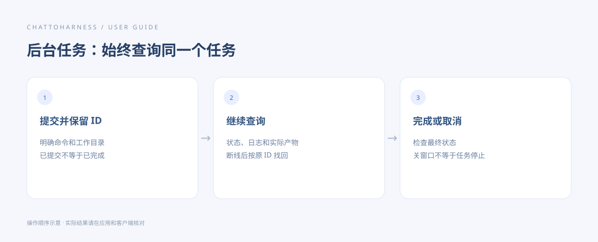

# 运行命令与交互会话

[English](../en/terminal.md) | [简体中文](../zh-CN/terminal.md) | [日本語](../ja/terminal.md)

> 适用于 ChatToHarness 0.6.0。

## 使用目标

让客户端在本机执行明确的命令，并按需要继续输入或读取输出。

## 开始前

电脑已安装所需命令，知道应在哪个目录运行。终端按当前用户权限执行。

## 操作步骤

1. 说明要运行的命令、实际工作目录和预期产物；不要只给模糊目标。
2. 对于短命令，检查返回输出和退出状态。
3. 需要交互时保留返回的会话标识，再发送输入或读取后续输出。
4. 让客户端列出会话，定位需要结束的那一个；停止时只使用对应会话。
5. 预计耗时较长或需要断线后查询时，改用持久后台任务。

### 可复制的示例

请将示例路径替换为本机已授权的工程绝对路径；Windows 使用自己的盘符路径。

```text
在 /Users/demo/ExampleProject 中只读检查当前目录和可用的 Git 版本，不修改文件。返回输出及退出状态。
```



操作指引示意图，展示操作顺序，不是客户端实际执行结果。

排查进程时，先列出本机进程并确定目标，再明确结束对应进程，不要误停其他程序。

## 完成后的表现

你能得到命令输出，并分清仍在运行、等待输入或已经结束。会话标识供后续操作使用。

## 没有成功时

工作目录授权不构成终端沙箱；命令可能访问网络或其他目录。连接超时不代表命令未执行。会话在重连后可能失效，先检查实际进程或产物，不要盲目重跑。

## 下一步

- [启动、查看和取消后台任务](background-tasks.md)
- [执行超时、状态未知或没有收到结果](uncertain-results.md)
- [了解访问范围、凭据与本地记录](privacy.md)
