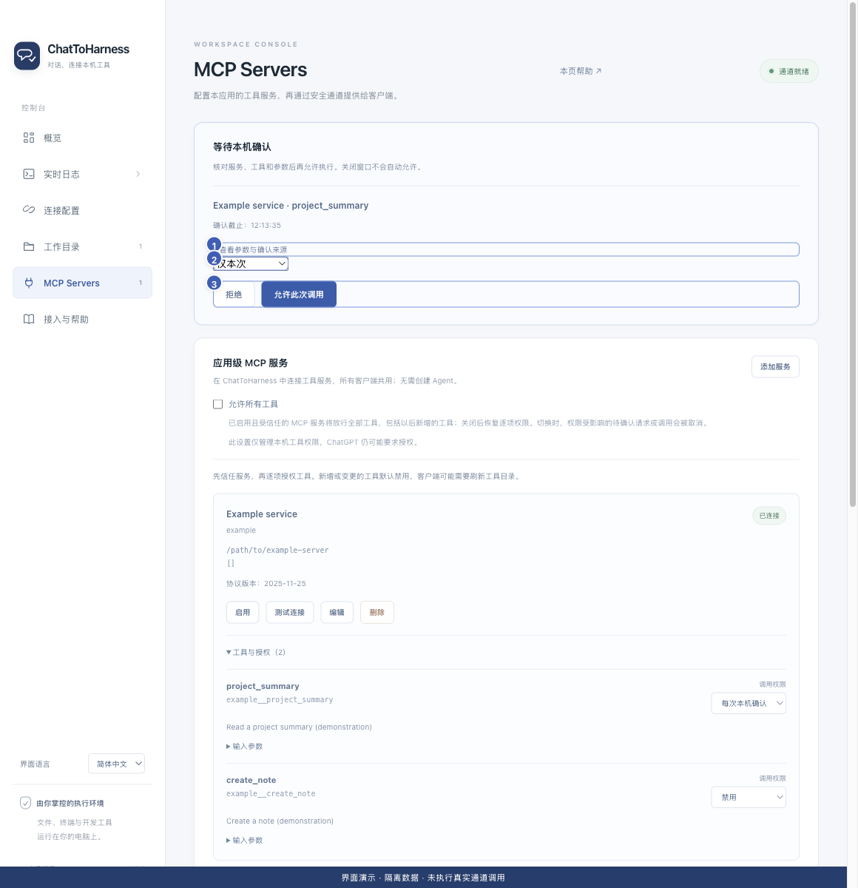

# 管理工具权限与本机确认

[English](../en/tool-permissions.md) | [简体中文](../zh-CN/tool-permissions.md) | [日本語](../ja/tool-permissions.md)

> 适用于 ChatToHarness 0.6.0。

## 使用目标

决定外部服务的哪些工具可用，以及每次是否需要本机确认。

## 开始前

服务已连接并取得你的信任，能够展开“工具与授权”。

## 操作步骤

1. 逐项选择“禁用”“直接调用”或“每次本机确认”。新增或变化的工具默认禁用。
2. 客户端发起待确认操作时，查看应用上方的确认卡片，展开参数并核对目标。
3. 选择仅本次、此项目内记住（有适用项目时）或记住此工具，再允许；不符合预期就拒绝。
4. 需要撤销记忆时，在工具列表恢复每次确认；项目记忆可使用“清除项目授权”。
5. 可选的“允许所有工具”会放行已启用且受信任服务的全部工具，也包括以后新增工具；关闭后恢复逐项设置。

1 查看参数；2 记忆范围；3 拒绝或允许。 界面演示：使用当前仓库界面与隔离示例数据，不代表真实通道或工具调用成功。

## 完成后的表现

客户端只能使用已获相应授权的工具。本机确认必须在调用时限内完成，关闭窗口不会自动允许。

## 没有成功时

配置、工具定义或项目变化可能使授权记忆失效。项目记忆不限制进程实际访问范围。本机允许不会关闭 ChatGPT 自身的确认。切换“允许所有工具”可能取消受影响的待确认请求或调用。

## 下一步

- [信任服务与测试连接](service-trust.md)
- [处理目录、密钥或工具授权失败](permission-problems.md)
- [了解访问范围、凭据与本地记录](privacy.md)
