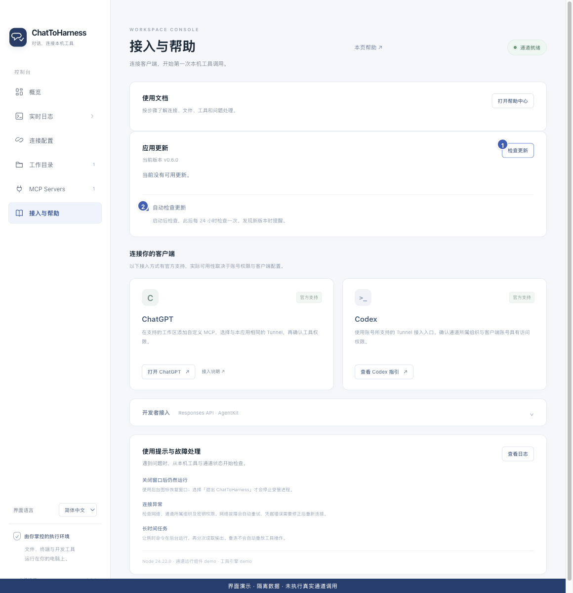

# 检查更新、安装新版与阅读说明

[English](../en/updates.md) | [简体中文](../zh-CN/updates.md) | [日本語](../ja/updates.md)

> 适用于 ChatToHarness 0.6.0。

## 使用目标

了解新版本内容，并按系统安装新版应用。

## 开始前

先保存未保存的设置与文件，并检查正在运行的任务，特别是独立持久任务。

## 操作步骤

1. 在“接入与帮助”的应用更新区域点击“检查更新”；菜单栏和托盘也提供入口。
2. 发现新版后先阅读版本说明，核对系统与签名提示。
3. 点击“下载并安装”，等待下载和完整性检查完成。
4. 通过校验后，应用停止连接、打开安装包并退出。Mac 将新版拖入应用程序，Windows 按向导安装。
5. 重新打开应用，核对版本和设置，再连接并做一次只读验证。
6. 按需要切换自动检查；默认启动约 10 秒后检查，此后每 24 小时检查，只提醒，不自动安装。

1 手动检查；2 自动检查偏好。 界面演示：使用当前仓库界面与隔离示例数据，不代表真实通道或工具调用成功。

## 完成后的表现

当前版本和更新状态清楚可见。校验失败、文件缺失或下载失败时不会启动安装。

## 没有成功时

更新检查不依赖通道。网络失败不影响现有工具连接。开发模式只检查版本；安装更新不会保证取消独立后台任务，请事先处理。

## 下一步

- [安装 ChatToHarness](installation.md)
- [启动、查看和取消后台任务](background-tasks.md)
- [了解访问范围、凭据与本地记录](privacy.md)
