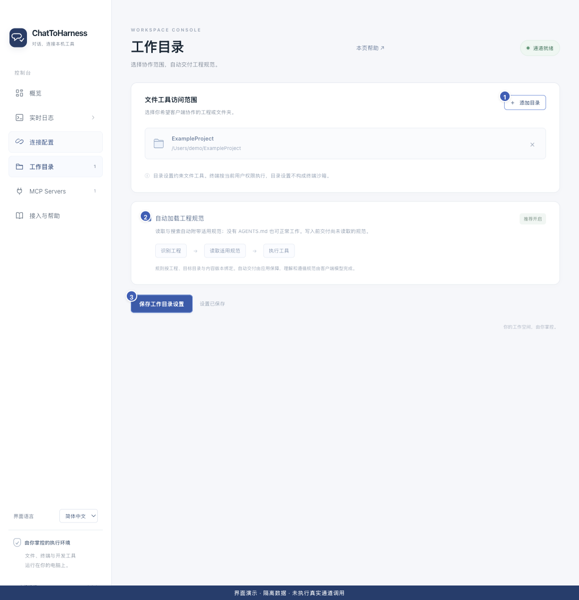

# 管理工作目录和项目规范

[English](../en/work-directories.md) | [简体中文](../zh-CN/work-directories.md) | [日本語](../ja/work-directories.md)

> 适用于 ChatToHarness 0.6.0。

## 使用目标

选择文件工具可访问的范围，并让客户端获得适用的项目说明。

## 开始前

只选择确实希望协作的文件夹。目录授权由本机应用管理。

## 操作步骤

1. 打开“工作目录”，点击“添加目录”，选择项目或文件夹，可添加多个。
2. 不再需要时点击该目录旁的移除按钮，再保存设置；移除不会删除磁盘文件。
3. 按需要保留“自动加载工程规范”开启，点击“保存工作目录设置”。
4. 在聊天中说明项目绝对路径；有 AGENTS.md 或相关规则时应用会交付适用说明，没有也能工作。
5. 首次写入若提示先读规范，让客户端读完再继续原操作。Skills 可按任务需要由客户端选读。

1 添加目录；2 自动加载规范；3 保存设置。 界面演示：使用当前仓库界面与隔离示例数据，不代表真实通道或工具调用成功。

## 完成后的表现

文件工具按已保存目录访问。客户端能获得适用项目规范；自动交付不等于模型一定理解或遵守。

## 没有成功时

读取规范异常可能只阻止写入，读取和排查可继续。改动规范后可能要求重读。目录授权不限制终端和第三方进程，项目授权记忆也不会把这些进程隔离到目录内。

## 下一步

- [浏览和整理文件](files.md)
- [处理目录、密钥或工具授权失败](permission-problems.md)
- [了解访问范围、凭据与本地记录](privacy.md)
